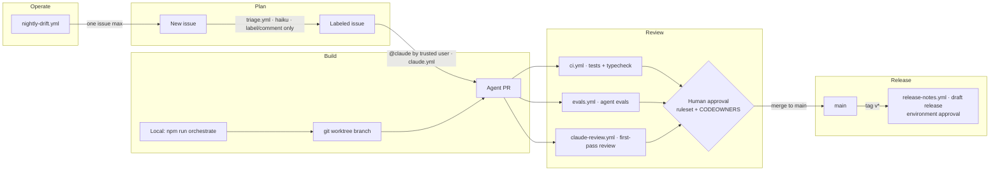

# Architecture

## Where agents act in the lifecycle



## Multi-agent orchestrator (`agents/orchestrator.ts`)

```
lead (sonnet, no edit tools)
 ├─ planner     (sonnet, read-only)      → Markdown plan + acceptance criteria
 ├─ implementer (sonnet, edit + npm)     → test-first changes      ◄─┐
 └─ reviewer    (opus,   read + git diff)→ JSON verdict ─ changes ───┘  (max 3 rounds)
```

- Subagents live in `.claude/agents/*.md`, so the same definitions work interactively in Claude Code and from the SDK.
- Handoffs use fixed formats (Markdown plan, JSON verdict, JSON outcome validated with zod).
- Isolation: run each orchestration in its own `git worktree` so parallel runs never edit the same files.
- Limits: `maxTurns: 60`, `maxBudgetUsd: 3`, 3 review rounds, then `gave_up` → a human takes over.

## Trust boundaries

| Input | Trusted? | Control |
|---|---|---|
| Issue / PR text from anyone | No | Triage agent has zero tools; CI agents get narrow `--allowedTools`; prompts say "untrusted data" |
| `@claude` comment | Only from OWNER/MEMBER/COLLABORATOR | `author_association` check in `claude.yml` |
| Agent file edits | Partially | `protect-paths.sh` hook blocks workflows, settings, hooks, CODEOWNERS |
| Agent shell commands | Partially | `.claude/settings.json` allow/deny rules; no `curl`, no force-push, no push to main |
| Merge to `main` | Human only | Ruleset: PR + 1 approval + required checks; CODEOWNERS on sensitive paths |
| Release | Human only | Draft release + `release` environment with required reviewers |

## Failure modes and responses

| Failure | Detection | Response |
|---|---|---|
| Prompt injection changes labels | `evals/cases.json` critical cases | CI fails the PR |
| Agent output not valid JSON | zod parse | Retry once, then throw |
| Agent loops / runs long | `maxTurns`, `maxBudgetUsd`, job `timeout-minutes` | Run stops; result subtype logged |
| Reviewer and implementer never agree | review round counter | `gave_up`, human picks up |
| Cost creep | `runs/runs.jsonl` + `npm run report` | Route cheap jobs to haiku, tighten turns |
