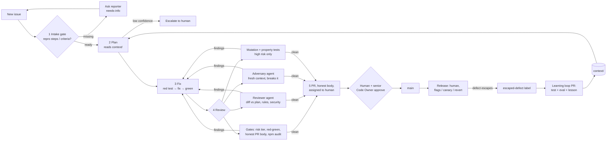

# Architecture

## Pipeline

## Agents

| Agent | Stage | Model | Tools | Output |
|---|---|---|---|---|
| `intake` | 1 | haiku | read issue | JSON: ready, missing, question, risk hint, confidence |
| `planner` | 2 | sonnet | read-only | Markdown plan: intent, risk tier, files, red test, criteria → tests, assumptions, confidence |
| `implementer` | 3 | sonnet | edit + test commands | red test output, results, not tested, assumptions, confidence |
| `reviewer` | 4 | opus | read + git diff + npm audit | JSON verdict: approve / changes_requested / escalate |
| `adversary` | 4 | opus | read + write only `test/adversarial/` | JSON: broke_it, failing cases, intent gaps, out-of-scope changes |

Definitions live in `.claude/agents/*.md` and are shared by Claude Code, the Agent SDK
orchestrator (`agents/orchestrator.ts`) and the CI prompts, so there is one source of truth.

## Shared context (`context/`)

Rules, service map, API contracts, risk tiers and lessons. Agents read it before planning; only
humans change rules and risk tiers. In an organization this is a separate repo checked out by
every workflow.

## Trust boundaries

| Input | Trusted? | Control |
|---|---|---|
| Issue / PR text from anyone (titles, bodies, comments, reviews) | No | 1) Deterministic input scan before any agent reads it: injection phrases, fake system turns, hidden text (HTML comments, base64, Unicode tags, bidi, zero-width), exfiltration and pasted secrets. Findings pause agents and label `prompt-injection`; a maintainer may add `scan-cleared` (never for secrets; removed when the text is edited). 2) Intake agent judges paraphrased injection and vulnerabilities. 3) Agents can only read, label, comment; evals pin both layers |
| `@claude` comment | Only from OWNER/MEMBER/COLLABORATOR, only on `ready` issues | `author_association` + label checks in `claude.yml` |
| Agent file edits | Partially | `protect-paths.sh` blocks workflows, settings, hooks, agent prompts, CODEOWNERS, rules, risk tiers |
| Agent shell commands | Partially | allow lists per workflow; deny list blocks merge, release, `gh api`, secrets, `curl` |
| Merge to `main` | Human only | Ruleset: PR + approval + Code Owner + required checks |
| Release | Human only | Draft release + `release` environment approval |

## Failure modes and responses

| Failure | Detection | Response |
|---|---|---|
| Vague ticket | Intake gate | Ask the reporter; no agent work starts |
| Fix doesn't address the real bug | Red-green check: new tests must fail on base | PR blocked |
| Fix passes its own tests but breaks edge cases | Adversary agent, property tests | Findings sent back to the implementer |
| Tests too weak to catch a wrong change | Mutation testing (break at 80%) | PR blocked for high risk |
| Change in money / auth / deletion code | Risk tier `high` | Senior Code Owner approval + stricter checks |
| Prompt injection | Input scan (intake, `@claude`, PR `gates`) + intake agent + eval critical cases | Agents paused; `gates` fails; maintainer reviews |
| Endless review loop (every round finds new edge cases, the PR grows) | `scripts/review-loop.ts`: 2-round budget, blocker-only failure, 300-line size budget, one sticky comment per agent | Agents stop and post a note; follow-ups become issues; a maintainer adds `review-again` or `large-pr` |
| Secret pasted in an issue or PR | Input scan `secret` rule | Labeled `security`; reporter told to rotate; cannot be cleared |
| Agent unsure | Confidence field | Escalate to a human |
| Defect reaches main | `escaped-defect` label | Learning loop: test + eval + lesson |
| Agent loops or runs long | `--max-turns`, `maxBudgetUsd`, job timeouts | Run stops; deterministic work moved into scripts |
